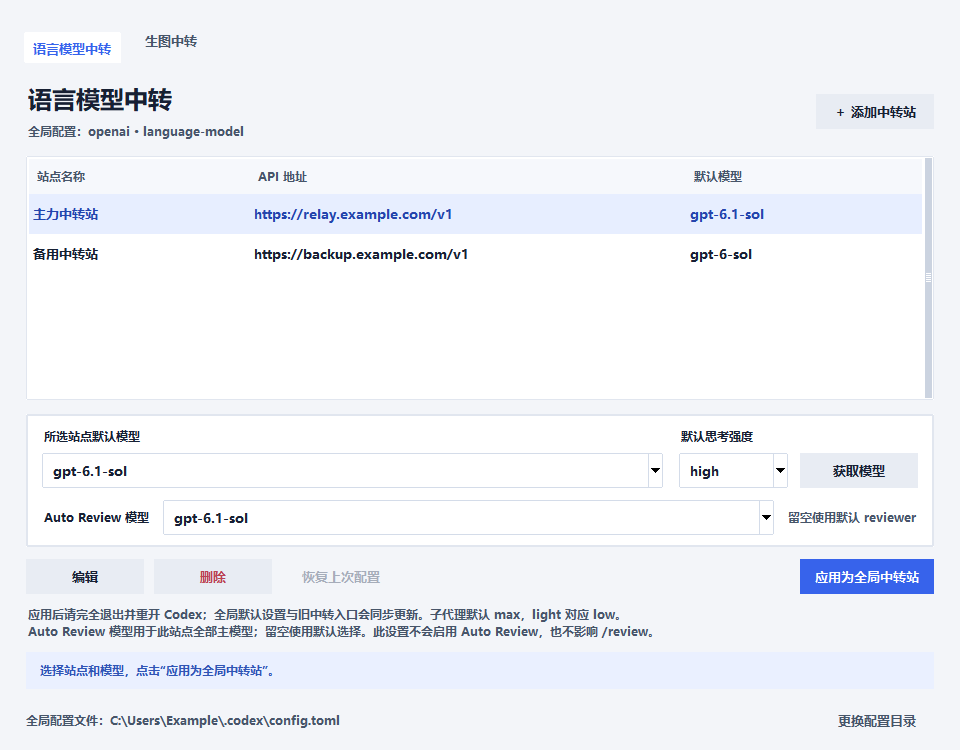
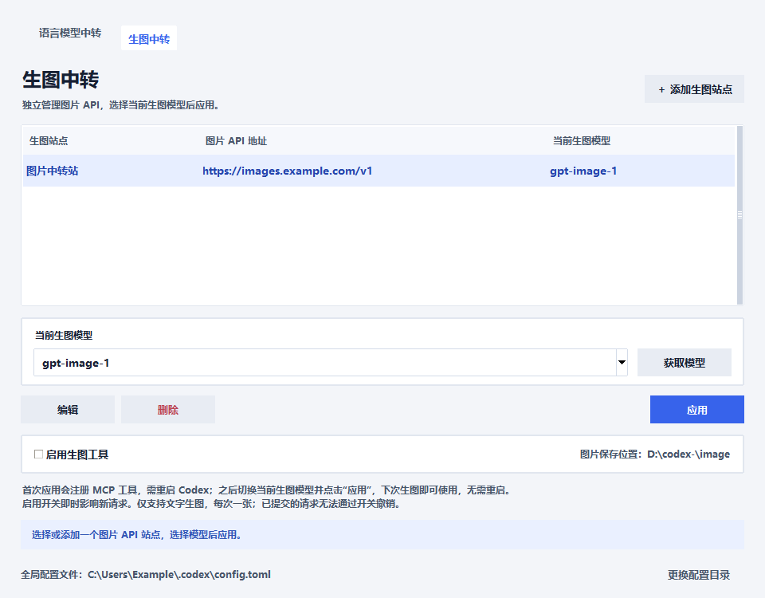

# Codex Relay Switcher

**在 Windows 上通过图形界面切换 Codex 中转站、模型和思考强度，并独立管理生图接口。**

保存常用站点后，选择模型并点击应用即可更新配置，减少反复手改 `config.toml` 的操作。适合经常在主力站、备用站和不同模型之间切换的 Codex 用户。

A Windows GUI for switching Codex relay providers, model defaults, reasoning effort, and a separate text-to-image API.

本项目是个人维护的第三方工具，与 OpenAI 无隶属关系。

## 界面预览

### 语言模型中转

集中管理站点、默认模型、子代理模型与推理强度和 Auto Review 模型。



### 生图中转

使用独立的图片接口与密钥，切换当前生图模型，并控制是否允许新的生图请求。



> 截图使用演示站点和示例模型，不包含真实密钥。截图中的模型名称不代表任何中转站的可用性承诺。

## 可以做什么

| 功能 | 说明 |
| --- | --- |
| 保存多个中转站 | 保存名称、API 地址与密钥，随时选择、编辑和应用 |
| 获取模型列表 | 读取站点的 `/models`，也支持手动输入模型 ID |
| 切换全局配置 | 更新默认站点、模型和模型目录，并同步程序识别到的旧中转入口 |
| 选择思考强度 | 主模型与子代理分别选择 `light`、`medium`、`high`、`xhigh`、`max`、`ultra`；主模型默认 `high`，子代理默认 `max` |
| 指定 Auto Review 模型 | 为每个站点保存可选的审核模型，避免沿用该站点不支持的模型 ID |
| 独立生图接口 | 语言模型与图片模型分开配置，通过本地 MCP 工具连接文字生图 API |
| 生图即时开关 | 运行 Codex 时允许或阻止新的生图请求，图片保存到本地 |
| 备份与恢复 | 语言模型配置应用前保留备份，可通过“恢复上次配置”回退 |

## 快速开始

### 运行条件

- Windows，安装 Python 3.11 或更高版本，并能使用 Tkinter。
- 已安装 Codex，并有可读取、写入的用户配置目录。
- 自行准备中转站提供的 API 地址、密钥和可用模型。

界面和 PNG 生图处理使用 Python 标准库，不需要额外安装界面框架。JPEG / WebP 图片的完整解码需要可选的 Pillow；程序不会自动安装依赖。

### 下载并启动

通过仓库页面的 **Code → Download ZIP** 下载并解压，或使用 Git：

```powershell
git clone https://github.com/Oescat/codex-relay-switcher.git
cd codex-relay-switcher
python relay_switcher.pyw
```

下载 ZIP 的用户，在解压后的项目目录执行最后一行即可。启动前可用 `python --version` 检查 Python 版本。

也可以双击 `启动中转站.bat`。该脚本目前固定查找下面的 Python 3.13 路径；如果你的安装位置不同，请使用上面的 Python 命令启动：

```text
%LocalAppData%\Programs\Python\Python313\pythonw.exe
```

### 配置语言模型

1. 打开 **语言模型中转**，点击 **添加中转站**，填写名称、API 地址和 API Key。
2. 点击 **获取模型**，选择默认模型；站点不提供模型列表时，可手动填写模型 ID。
3. 保存站点，在主界面选择模型、默认思考强度、**子代理模型**、**子代理推理强度**，以及可选的 Auto Review 模型。
4. 点击 **应用为全局中转站**，完全退出并重新打开 Codex，再使用已有或新对话。

子代理模型和推理强度随站点保存。子代理模型可从该站点的模型列表中选择，也可手动输入；留空让 Codex 自行选择。点击 **应用为全局中转站** 后，模型写入 `[agents].default_subagent_model`，强度写入 `[agents].default_subagent_reasoning_effort`。旧站点没有这些选项时，模型默认为空、强度默认为 `max`；首次导入已有配置时保留其中有效值。主模型的默认思考强度仍为 `high`，两者独立。界面中的 `light` 写入为 `low`。

获取语言模型列表时，程序同时刷新 OpenAI 官方 Codex 模型目录并缓存在 `<CODEX_HOME>\relay-switcher\official_model_catalog.json`。应用中转站时按模型 ID 匹配官方能力，再依次使用已有 Codex 缓存和程序内置目录；官方目录不可用时保留已缓存版本。官方目录只说明 Codex 的模型能力，不保证第三方中转站实际支持相同接口或参数。

**语言模型配置切换或恢复后，需要重开 Codex。** 已经运行的对话可能仍保留旧配置或连接。

Auto Review 模型留空时由 Codex 默认选择；填写时，模型 ID 必须受所选站点支持。此设置通过站点模型目录应用到该站点的各个主模型，**不会启用 Auto Review，也不修改独立的 `/review` 模型设置**。

### 配置文字生图

1. 打开 **生图中转**，添加图片站点，填写其 API 根地址和独立的图片 API Key。
2. 获取模型列表或手动输入图片模型 ID，确认该模型支持 `/images/generations`。
3. 选择 **当前生图模型** 并点击 **应用**。首次注册 MCP 工具后，完全退出并重开 Codex。
4. 在对话中明确提出生图请求，例如：“请生成一张白色背景的橘猫插画。”

MCP 是让 Codex 调用外部工具的连接方式。本项目通过本地 MCP 服务提交生图请求，并返回图片内容与本地路径；实际工具发现、调用和图片预览仍依赖所用 Codex 客户端与对话模型的支持。

| 操作 | 是否需要重开 Codex |
| --- | --- |
| 首次注册生图 MCP 工具 | 需要 |
| 更换当前生图模型并点击“应用” | 注册未变化时不需要，下次生图使用新模型 |
| 更换图片站点或密钥并重新应用 | 注册未变化时不需要，下次请求使用新配置 |
| 切换“启用生图工具” | 不需要，影响新的请求 |

图片目前统一保存到 **`D:\codex-\image`**，程序会在请求前创建目录并检查写入权限；请确保电脑有可用的 D 盘。每次调用生成一张图片，失败或超时不会自动重试。已经提交的请求不受后续切换影响，关闭开关无法撤销它们。

修改当前生图站点的地址、密钥或模型会先关闭生图，需要重新应用或启用。关闭 Switcher 窗口不会停止 MCP 服务；关闭生图开关后，工具仍保留注册，但会拒绝新的生图请求。

MCP 注册使用程序与 Python 的绝对路径。配置后请保留项目目录的位置；移动目录或更换 Python 后，应重新应用，并在注册发生变化时重开 Codex。

## 配置与密钥保存在哪里

默认配置目录为 `%USERPROFILE%\.codex`，也可以通过 `CODEX_HOME` 环境变量或界面中的 **更换配置目录** 指定。以下 `<CODEX_HOME>` 表示实际使用的配置目录。

| 内容 | 位置与处理方式 |
| --- | --- |
| Codex 生效配置 | `<CODEX_HOME>\config.toml` |
| 已保存的语言模型站点 | `<CODEX_HOME>\relay-switcher\profiles.dpapi`，Windows DPAPI 加密 |
| 语言模型切换前的备份 | `<CODEX_HOME>\relay-switcher\backup.dpapi`，Windows DPAPI 加密 |
| 图片站点、独立密钥与开关 | `<CODEX_HOME>\relay-switcher\image-profiles.dpapi`，Windows DPAPI 加密 |
| 首次生图注册前的配置备份 | `<CODEX_HOME>\relay-switcher\image-mcp-backup.dpapi`，Windows DPAPI 加密 |
| OpenAI 官方 Codex 模型能力缓存 | `<CODEX_HOME>\relay-switcher\official_model_catalog.json`，获取语言模型时刷新 |
| 生成的模型目录 | `<CODEX_HOME>\relay-switcher` 下 |
| 生成图片 | `D:\codex-\image` |

**站点存储加密不代表所有生效配置都加密。** 当前语言模型接入方式会将密钥写入 `config.toml` 的 provider 配置，必须保护该文件。图片密钥单独加密保存，不写入 `config.toml`、MCP 命令行或环境变量。

获取模型列表和调用接口时，会向你选择的中转服务发送相应密钥；生图时还会发送提示词和生成参数。服务提供方的数据处理规则由其自身决定。

不要把真实密钥、`config.toml`、`auth.json`、DPAPI 文件、备份或验证文件上传到公开仓库或附在 Issue 中。仓库已经配置相关忽略规则，分享前仍应检查文件；迁移到新电脑时应重新添加密钥，不要假定 DPAPI 文件可跨电脑解密。

## 当前兼容范围

- **语言模型：** 写入供 Codex 使用的 OpenAI Responses 兼容中转配置。模型目录可读取不等于所有模型都能稳定对话、调用工具或处理长上下文，需按所用站点实际验证。
- **思考强度：** 界面中的 `light` 写入为 Codex 的 `low`；所选强度是否可用取决于模型和中转站支持情况。
- **文字生图：** 使用 OpenAI 兼容的 `/v1/images/generations`，支持提示词、尺寸与画质参数；不包含图片编辑、视频或原生 Anthropic Messages 协议适配。
- **桌面配置：** 语言模型应用时还会写入 `conversationDetailMode = "STEPS_COMMANDS"`。Codex 更新可能改变配置或模型目录的解释方式，请以所用客户端实际表现为准。
- **审批：** 本项目不会修改 Codex 的全局审批策略。启用生图工具后，客户端仍可能要求审批。

## 测试与反馈

在项目目录运行：

```powershell
python -m unittest -v
```

测试覆盖全局配置、模型目录、生图配置与校验、MCP 注册与协议、以及界面操作。部分测试依赖 Windows DPAPI；测试使用合成凭据和模拟接口，不验证真实中转站的计费与可用性。

遇到问题可以通过仓库的 **Issues** 反馈。请附 Windows、Python 和 Codex 版本、复现步骤及已脱敏的错误信息，切勿附上密钥或完整配置文件。

