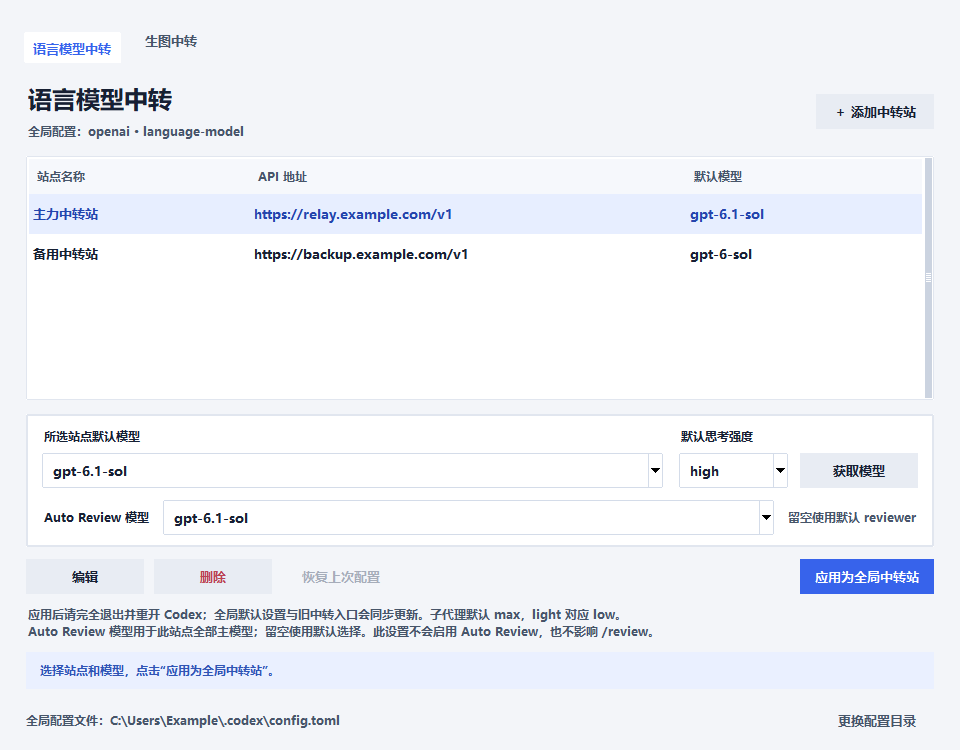
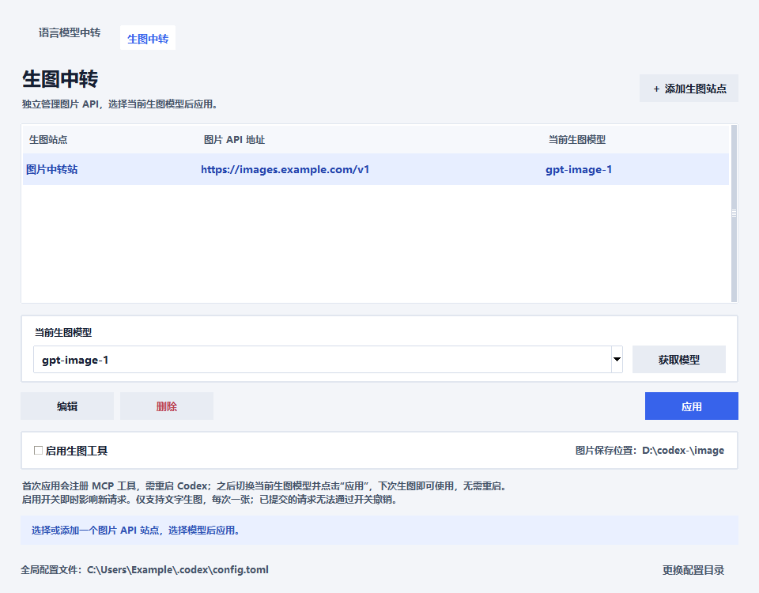

# Codex Relay Switcher

**在 Windows 上通过图形界面切换 Codex 中转站、模型和思考强度，并独立管理生图接口。**

保存常用站点后，选择模型并点击应用即可更新配置，减少反复手改 `config.toml` 的操作。适合经常在主力站、备用站和不同模型之间切换的 Codex 用户。

A Windows GUI for switching Codex relay providers, model defaults, reasoning effort, and a separate image generation/edit API.

本项目是个人维护的第三方工具，与 OpenAI 无隶属关系。

## 界面预览

### 语言模型中转

集中管理站点、默认模型、子代理模型与推理强度和 Auto Review 模型。



### 生图中转

使用独立的图片接口与密钥，切换当前生图模型，并控制是否允许新的生图请求。



> 截图使用演示站点和示例模型，不包含真实密钥。截图中的模型名称不代表任何中转站的可用性承诺。

## 可以做什么

| 功能 | 说明 |
| --- | --- |
| 保存多个中转站 | 保存名称、API 地址与密钥，随时选择、编辑和应用 |
| 获取模型列表 | 读取站点的 `/models`，也支持手动输入模型 ID |
| 切换全局配置 | 更新默认站点、模型和模型目录，并同步程序识别到的旧中转入口 |
| 选择思考强度 | 主模型与子代理分别选择 `light`、`medium`、`high`、`xhigh`、`max`、`ultra`；主模型默认 `high`，子代理默认 `max` |
| 指定 Auto Review 模型 | 为每个站点保存可选的审核模型，避免沿用该站点不支持的模型 ID |
| 独立生图接口 | 语言模型与图片模型分开配置，通过本地 MCP 工具连接文字生图与参考图编辑 API |
| 生图即时开关 | 运行 Codex 时允许或阻止新的生图请求，图片保存到本地 |
| 备份与恢复 | 语言模型配置应用前保留备份，可通过“恢复上次配置”回退 |

## 快速开始

### 运行条件

- Windows，安装 Python 3.11 或更高版本，并能使用 Tkinter。
- 已安装 Codex，并有可读取、写入的用户配置目录。
- 自行准备中转站提供的 API 地址、密钥和可用模型。

界面和 PNG 生图处理使用 Python 标准库，不需要额外安装界面框架。JPEG / WebP 图片的完整解码需要可选的 Pillow；程序不会自动安装依赖。

### 下载并启动

通过仓库页面的 **Code → Download ZIP** 下载并解压，或使用 Git：

```powershell
git clone https://github.com/Oescat/codex-relay-switcher.git
cd codex-relay-switcher
python relay_switcher.pyw
```

下载 ZIP 的用户，在解压后的项目目录执行最后一行即可。启动前可用 `python --version` 检查 Python 版本。

也可以双击 `启动中转站.bat`。该脚本目前固定查找下面的 Python 3.13 路径；如果你的安装位置不同，请使用上面的 Python 命令启动：

```text
%LocalAppData%\Programs\Python\Python313\pythonw.exe
```

### 配置语言模型

1. 打开 **语言模型中转**，点击 **添加中转站**，填写名称、API 地址和 API Key。
2. 点击 **获取模型**，选择默认模型；站点不提供模型列表时，可手动填写模型 ID。
3. 保存站点，在主界面选择模型、默认思考强度、**子代理模型**、**子代理推理强度**，以及可选的 Auto Review 模型。
4. 点击 **应用为全局中转站**，完全退出并重新打开 Codex，再使用已有或新对话。

子代理模型可从该站点的模型列表中选择，也可手动输入；留空让 Codex 自行选择。点击 **应用为全局中转站** 后，模型写入 `[agents].default_subagent_model`，强度写入 `[agents].default_subagent_reasoning_effort`。主模型与子代理各自按站点、模型记住推理强度。默认优先选择主模型 `high`、子代理 `max`；所选模型不支持该档位时，使用目录提供的有效默认值。界面中的 `light` 写入为 `low`。

切换或手动输入模型时，两个推理下拉框会分别读取本地能力目录。已知模型仅显示其支持的档位；目录明确没有可选档位时显示 `auto`，应用时移除强度覆盖项。`auto` 表示不覆盖，与目录中的字面档位 `none` 不同；目录提供 `none`、`minimal` 时会保留这些选项。未知模型保留常用档位及原选择，并标明“能力未知”；子代理模型留空时无法预先校验其最终模型。应用前再次校验，并以同一份能力数据生成 Codex 模型目录。

获取语言模型列表时，程序同时刷新 OpenAI 官方 Codex 模型目录并缓存在 `<CODEX_HOME>\relay-switcher\official_model_catalog.json`。读取能力时优先保留用户显式指定的外部模型目录，再依次使用官方能力缓存、Codex 缓存和程序内置目录；程序自身生成的目录不会反过来作为能力来源。官方刷新失败时保留已缓存版本。官方目录只说明 Codex 的模型能力，不保证第三方中转站实际支持相同接口或参数；与已安装客户端版本的兼容性仍需实际验证。

使用显式外部模型目录时，生成目录旁的 `.source.json` 记录原始目录路径，防止应用后丢失来源；再次读取时仍读取原始目录的更新。该记录不含密钥。旧版本生成的目录没有来源记录，无法仅凭生成内容重建原始来源，需要重新指定原始目录。

生成模型目录时会保留新版 `model_messages`，并为缺少 `base_instructions` 的条目从原始指令模板补齐该字段，供仍要求旧格式的 CLI 使用。已有的 `base_instructions` 保持原样；旧版 Switcher 已生成的目录需要重新应用后才会更新。

**语言模型配置切换或恢复后，需要重开 Codex。** 已经运行的对话可能仍保留旧配置或连接。

点击 **应用为全局中转站** 时，同时写入以下全局默认设置，并替换配置文件中原来的 `sandbox_mode`、`approval_policy`、`approvals_reviewer` 和 `web_search`：

```toml
sandbox_mode = "danger-full-access"
approval_policy = "on-request"
approvals_reviewer = "auto_review"
web_search = "live"
```

`web_search = "live"` 明确选择实时网页搜索，替换原来的缓存或禁用设置。重开 Codex 后，在“用户配置”中检查“网页搜索”是否显示“实时”；中转站能否实际执行搜索仍需验证。恢复上次配置时，也会恢复原来的搜索设置。仅应用生图配置不会修改网页搜索方式。

这组设置保留全盘文件访问，并为需要审批的操作启用 Auto Review。`danger-full-access` 不要求审批策略只能是 `never`；桌面端名称为 **Full Access** 的固定预设才使用 `never`。

**Codex 桌面端还需选择实际权限模式。** 应用后完全退出并重开 Codex，在对话权限菜单选择 **自定义（config.toml）**，以读取上述组合。它仍提供全盘访问；**替我审批（Approve for me）** 使用工作区沙箱，不符合这里保留全盘访问的目标。本程序更新配置文件，不操作桌面端权限菜单；继续选择 Full Access 预设会选回 `never`。请检查新对话实际是否为 `danger-full-access`、`on-request`、`auto_review`。自定义模式的可用性取决于客户端版本和环境，未在用户客户端实际验证。

自动审批生效后，已经允许的操作直接执行，需要审批的合适请求由 Auto Review 判断。Auto Review 模型留空时由 Codex 默认选择；填写时，模型 ID 必须受所选站点支持。此模型设置通过站点模型目录应用到该站点的各个主模型，不修改独立的 `/review` 模型设置。恢复上次配置时，配置文件中的审批设置一并恢复。客户端权限选择或启动参数仍可能覆盖全局默认值。

### 配置生图与参考图编辑

1. 打开 **生图中转**，添加图片站点，填写其 API 根地址和独立的图片 API Key。
2. 获取模型列表或手动输入图片模型 ID，确认该模型支持 `/images/generations`。
3. 选择 **当前生图模型**、**默认画质** 和 **默认尺寸**，然后点击 **应用**。画质和尺寸按站点、模型保存；旧配置沿用 `low` 和 `1024x1024`。首次注册 MCP 工具或更新本次工具参数后，完全退出并重开 Codex。
4. 在对话中明确提出生图请求，例如：“请生成一张白色背景的橘猫插画。”

MCP 是让 Codex 调用外部工具的连接方式。本项目通过本地 MCP 服务提交生图请求，并返回图片内容与本地路径；实际工具发现、调用和图片预览仍依赖所用 Codex 客户端与对话模型的支持。

工具仍叫 `generate_image`。只提供 `prompt` 时走 `/v1/images/generations`；提供 `input_images`（1 至 4 个绝对本地 PNG、JPEG 或 WebP 路径）时走 `/v1/images/edits`。可选 `mask` 为一张与单张参考图同尺寸、带透明通道的 PNG。参考图每张最多 25 MiB、合计（含遮罩）最多 50 MiB；单边最多 4096、最多 16777216 像素。这些是本程序的输入限制，服务端还可能有额外要求。

对话中可明确要求：“使用这张本地图片编辑背景”，并提供本地路径。聊天附件必须先有工具可读取的本地文件；Switcher 不会自动读取 Canva 云端素材。调用时可用 `model` 临时选择当前站点已缓存的另一个图片模型，也可覆盖 `quality`、`size`；临时覆盖不会修改页面中的当前模型。省略参数时使用该模型保存的画质和尺寸。

画质支持请求值 `auto`、`low`、`medium`、`high`，以及显式扩展值 `xhigh`、`max`。后两项不代表已验证 Flare、Sunburst 或其他模型支持它们。尺寸可填写 `auto` 或正整数 `宽x高`；本地要求单边不超过 4096、像素总数不超过 16777216，具体模型还可能有步长或比例要求。接口拒绝请求时会报告错误，不会自动换模型、降档或再次计费重试。

Canva 继续通过已安装的 Canva 插件使用：对话中的文字模型负责理解任务并调用 Canva 工具，图片模型负责生成或编辑位图。生成的图片可以作为设计素材；把图片放进 Canva 需要插件可用的上传或导入工具，仅有本地路径不等于已经导入，上传素材也不会自动变成可逐层编辑的设计。本项目没有新增 Canva 登录或授权管理。

| 操作 | 是否需要重开 Codex |
| --- | --- |
| 首次注册生图 MCP 工具 | 需要 |
| 更新程序以增加 MCP 参数或修改工具说明 | 需要，让新进程加载新版工具 |
| 更换当前生图模型并点击“应用” | 注册未变化时不需要，下次生图使用新模型 |
| 更换默认画质、尺寸或调用时临时覆盖参数 | 新版工具已加载时不需要 |
| 更换图片站点或密钥并重新应用 | 注册未变化时不需要，下次请求使用新配置 |
| 切换“启用生图工具” | 不需要，影响新的请求 |

图片目前统一保存到 **`D:\codex-\image`**，程序会在请求前创建目录并检查写入权限；请确保电脑有可用的 D 盘。每次调用生成一张图片，失败或超时不会自动重试。已经提交的请求不受后续切换影响，关闭开关无法撤销它们。

修改当前生图站点的地址、密钥或模型会先关闭生图，需要重新应用或启用。关闭 Switcher 窗口不会停止 MCP 服务；关闭生图开关后，工具仍保留注册，但会拒绝新的生图请求。

MCP 注册使用程序与 Python 的绝对路径。移动目录或更换 Python 后，重新应用可更新本程序的旧注册，并在注册发生变化时重开 Codex。重新应用会保留 Codex 添加的工具设置、环境变量与自定义超时；同名但指向其他程序或其他 Codex 配置目录的注册仍会报冲突。

## 本地 Infinite Canvas 同步

完整交接记录见 [适配 Infinite Canvas 的说明](INFINITE_CANVAS_ADAPTATION.md)，包含问题原因、修复、补丁应用、新电脑配置和未解决事项。Canvas 是独立安装的软件，本包不包含 Canvas 本体、画布数据或任何授权。

可选认证入口是 integrations/repair-canvas-mcp-auth.ps1。Canva 重新授权曾恢复 ready；GitHub OAuth 登录退出成功后，实际 MCP 仍要求 PAT，最终通过本机环境变量引用恢复 ready。因此脚本的 -Server github 仅发起 OAuth，不保证解决 PAT 分支。新电脑需自行授权，不能复制原电脑令牌；切换 CLI 也不能替代第三方登录。

已为本机 `D:\AI-Tools\Infinite-Canvas` 的本地开发服务增加图片渠道同步，适配补丁保存在 `integrations/infinite-canvas.patch`。此功能仅用于本地版，不作用于 `canvas.best` 在线版，也不转发图片请求。

1. 在 Switcher 的 **生图中转** 页面选择站点并点击 **应用**。
2. 刷新本地 Canvas，在 **配置 → 渠道** 中找到 **Switcher 生图 · 站点名称**。
3. 首次在这个渠道内手动添加图片模型，标记为 **生图**，再在 Canvas 选择使用。模型、调用脚本、画质、尺寸和张数仍由 Canvas 管理，不从 Switcher 复制。
4. 以后在 Switcher 应用其他图片站点，专用渠道的地址和密钥自动更新，Canvas 中原有模型和其他渠道保留。每次通过这个渠道生图、参考图编辑或获取模型列表前，还会重新读取连接信息；读取失败会阻止本次请求，不沿用旧密钥。

同步读取的是已应用的图片站点，不是语言模型站点；仅选中列表而未应用不会切换渠道。修改当前图片站点的连接信息后也会更新。Switcher 的 MCP 生图开关只控制该 MCP，不关闭 Canvas 的直接请求；Canvas 生成结果仍按 Canvas 的方式保存，不自动写入 `D:\codex-\image`。

本地网页启动时通过 Python 私有管道读取当前用户的图片配置，使用同源、禁止缓存的接口传给浏览器；不把密钥放入 URL、日志或 Git。Canvas 会像手工配置一样，将地址和密钥持久化到当前浏览器本地，这与 Switcher 原有的 DPAPI 加密存储是两份数据。

本机适配默认读取 `D:\Switch api` 中的辅助入口及默认 Codex 配置目录。如安装位置、Python 或 Codex 配置目录不同，在启动本地网页前分别设置非密钥环境变量 `RELAY_SWITCHER_ROOT`、`RELAY_SWITCHER_PYTHON`、`RELAY_SWITCHER_HOME`。此适配依赖本地 Vite 开发服务，上游升级或改用静态部署时需要重新处理补丁。不要在终端手动运行辅助入口的连接输出模式，以免显示密钥。

本机 Canvas 聊天侧栏按画布 ID 保存独立对话：打开或切换画布时自动恢复对应聊天，首次打开没有绑定的画布时创建空对话；“新对话”只影响当前画布，旧聊天保留在该画布的历史中。已有共享对话的归属应由用户指定，本包不含私人线程绑定。已有消息的对话恢复失败时保留原记录；确认未发送消息、尚未落盘的空对话可以自动重建。Agent 仍同时只运行一个任务，进行中的任务不会改到其他画布；切换后需等待原任务结束及 MCP 初始化。

## 配置与密钥保存在哪里

默认配置目录为 `%USERPROFILE%\.codex`，也可以通过 `CODEX_HOME` 环境变量或界面中的 **更换配置目录** 指定。以下 `<CODEX_HOME>` 表示实际使用的配置目录。

| 内容 | 位置与处理方式 |
| --- | --- |
| Codex 生效配置 | `<CODEX_HOME>\config.toml` |
| 已保存的语言模型站点 | `<CODEX_HOME>\relay-switcher\profiles.dpapi`，Windows DPAPI 加密 |
| 语言模型切换前的备份 | `<CODEX_HOME>\relay-switcher\backup.dpapi`，Windows DPAPI 加密 |
| 图片站点、独立密钥与开关 | `<CODEX_HOME>\relay-switcher\image-profiles.dpapi`，Windows DPAPI 加密 |
| 首次生图注册前的配置备份 | `<CODEX_HOME>\relay-switcher\image-mcp-backup.dpapi`，Windows DPAPI 加密 |
| OpenAI 官方 Codex 模型能力缓存 | `<CODEX_HOME>\relay-switcher\official_model_catalog.json`，获取语言模型时刷新 |
| 生成的模型目录 | `<CODEX_HOME>\relay-switcher` 下 |
| 生成图片 | `D:\codex-\image` |

**站点存储加密不代表所有生效配置都加密。** 当前语言模型接入方式会将密钥写入 `config.toml` 的 provider 配置，必须保护该文件。图片密钥单独加密保存，不写入 `config.toml`、MCP 命令行或环境变量。

获取模型列表和调用接口时，会向你选择的中转服务发送相应密钥；生图时还会发送提示词和生成参数，参考图编辑会发送所选图片和可选遮罩。服务提供方的数据处理规则由其自身决定。

不要把真实密钥、`config.toml`、`auth.json`、DPAPI 文件、备份或验证文件上传到公开仓库或附在 Issue 中。仓库已经配置相关忽略规则，分享前仍应检查文件；迁移到新电脑时应重新添加密钥，不要假定 DPAPI 文件可跨电脑解密。

## 当前兼容范围

- **语言模型：** 写入供 Codex 使用的 OpenAI Responses 兼容中转配置。模型目录可读取不等于所有模型都能稳定对话、调用工具或处理长上下文，需按所用站点实际验证。
- **思考强度：** 已知模型按本地目录限制档位；未知模型保留选择并显示未知。界面中的 `light` 写入为 Codex 的 `low`；中转站是否真正执行所选强度仍需实际验证。
- **生图与编辑：** 使用 OpenAI 兼容的 `/v1/images/generations` 和 multipart `/v1/images/edits`。已离线验证请求构造及保存流程，未证明特定中转站或图片模型支持所有参数。不包含视频或原生 Anthropic Messages 协议适配。
- **桌面配置：** 当前 Codex 报告旧版兼容项 `conversationDetailMode` 为无法识别的配置。语言模型应用时会移除原有的顶层字段，并停止写入；不自动猜测替代字段。Codex 更新可能改变配置或模型目录的解释方式，请以所用客户端实际表现为准。
- **审批：** 应用语言模型全局配置时，写入 `danger-full-access`、`on-request` 和 `auto_review`；仅应用生图配置不会修改全局审批策略。仅需要审批的请求进入审核，不保证所有操作都会被审核或批准；明确的禁止规则仍可能拒绝执行。实际行为取决于 Codex 客户端、当前权限模式和审核模型是否可用。

## 测试与反馈

在项目目录运行：

```powershell
python -m unittest -v
```

测试覆盖全局配置、模型目录、生图配置与校验、MCP 注册与协议、以及界面操作。部分测试依赖 Windows DPAPI；测试使用合成凭据和模拟接口，不验证真实中转站的计费与可用性。

遇到问题可以通过仓库的 **Issues** 反馈。请附 Windows、Python 和 Codex 版本、复现步骤及已脱敏的错误信息，切勿附上密钥或完整配置文件。

